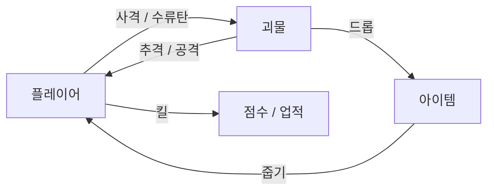
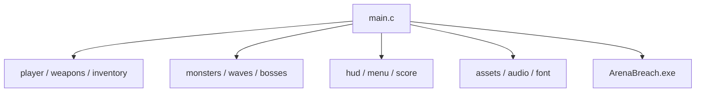
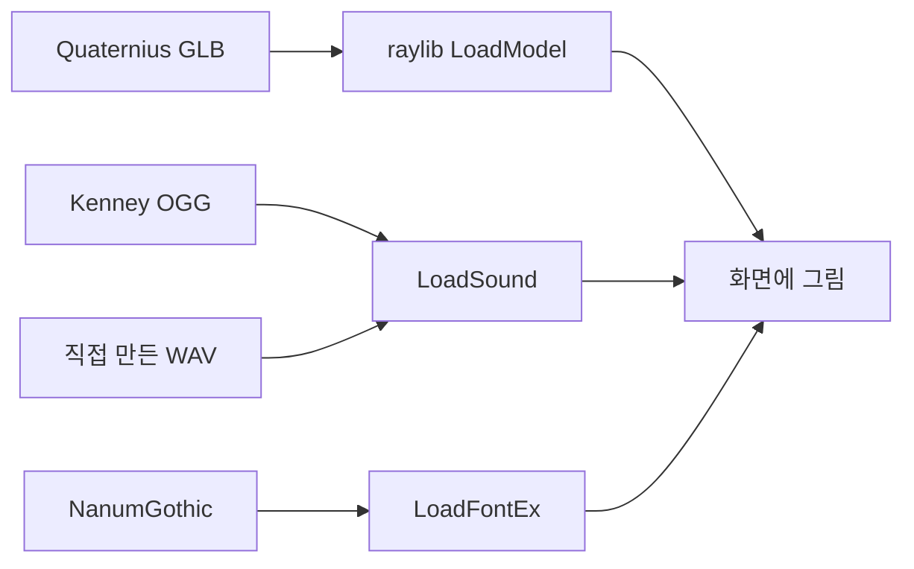

https://github.com/user-attachments/assets/7cf154ca-1a04-479f-9bdd-96bc94a1ae4a

# Arena Breach

C / raylib 6.2 · 3D 탑다운 슈터

> 초록 링 = 나 · 빨간 링 = 적

자세한 조작·팁은 [docs/GAME_GUIDE.md](docs/GAME_GUIDE.md)

---

## 슬라이드 1 · 뭐 만든 거?

아레나 안에서 살아남는 슈팅 게임.

- 위에서 비스듬히 내려다보는 시점
- 괴물 30종 + 경고 웨이브 + 보스
- ESC 누르면 도감 / 업적 / 랭킹



---

## 슬라이드 2 · 어떻게 돌림?

진입점: `src/main.c`  
→ 여기가 나머지 `.c`를 끌어와서, **main만 빌드하면 끝**

### 제일 쉬운 방법

프로젝트 루트에서:

```bat
build.bat
ArenaBreach.exe
```

`mingw32-make` 해도 동일.

### 직접 gcc 칠 때

```bat
gcc -std=c11 -O2 -Isrc -Ithird_party/raylib-6.2_win64_mingw-w64/include ^
  src/main.c -o ArenaBreach.exe ^
  -Lthird_party/raylib-6.2_win64_mingw-w64/lib -lraylib -lopengl32 -lgdi32 -lwinmm
```

VS 쓸 거면 `ArenaBreach.sln` 열고 **x86 또는 x64** 아무거나 빌드/실행 (둘 다 raylib 들어 있음).

> 주의: `assets` 옆에 두고 루트에서 실행할 것. 안 그러면 모델/한글/소리 안 뜸.



---

## 슬라이드 3 · 플레이 흐름

시작하자마자 밑에 팁 나옴. **Enter**로 넘김.

| # | 팁 |
|---|-----|
| 1 | WASD 이동 |
| 2 | 마우스 조준 + 좌클릭 사격 |
| 3 | Z 수류탄 |
| 4 | 아이템 옆에서 C 줍기 |
| 5 | B 가방 (드래그 / 1~8) |
| 6 | ESC 도감·코스튬 |

죽었다 → **Enter** 재시작 · 끌 거면 **F4**

---

## 슬라이드 4 · 키 정리

```text
  WASD ........ 이동
  마우스 ...... 조준 / 좌클릭 사격
  Space/Shift . 점프 / 대시
  Z X C B ..... 수류탄 / 무기 / 줍기 / 가방
  1~8 ......... 핫바
  Q E R ....... 광폭화 / 방벽 / 과충전
  ESC ......... 메뉴
  메뉴 1~5 .... 일시정지 | 도감 | 코스튬 | 업적 | 랭킹
```

---

## 슬라이드 5 · 기능 요약

### 전투
무기 3종 + 수류탄 + Q/E/R. 건물 뒤에 숨으면 총알 막힘.

### 적
| 종류 | 뭐함 |
|------|------|
| 일반 30종 | 각자 특수능력 (흡혈, 독, 분열 …) |
| 평소 스폰 | 사방에서 천천히 옴 |
| Warning | 한 방향으로 확 밀어붙임 |
| 보스 3 | 무리의 왕 / 역병의 어미 / 그림자 거신 |

### 성장
킬 → 점수·콤보. 100킬마다 난이도↑, 50킬마다 배경 바뀜.  
몬스터 북 먹으면 도감 해금, 코스튬 끼면 그 능력 씀.

### ESC 메뉴
업적 / 랭킹 TOP10 (`save/ranking.txt`) / 도감 알림

---

## 슬라이드 6 · 에셋 출처

상업용 OK인 것만 씀. 자세한 건 [assets/LICENSE](assets/LICENSE)

| 뭐 | 어디서 | 라이선스 |
|----|--------|----------|
| 3D 모델·건물·드롭 | [Quaternius](https://quaternius.com) | CC0 |
| 사격·피격·줍기 소리 | [Kenney](https://kenney.nl) | CC0 |
| 폭발·보스·일시정지 소리 | `tools/gen_sfx.py`로 직접 만듦 | 오리지널 |
| 한글 폰트 | Nanum Gothic | OFL |
| 엔진 | [raylib 6.2](https://github.com/raysan5/raylib) | zlib |

몬스터 이름·능력 설명은 우리 쪽 창작. 특정 IP 베낀 거 아님.



---

## 슬라이드 7 · raylib 뭘 썼나

엔진 하나로 창·입력·3D·소리·폰트·파일까지 처리함.

| 영역 | 쓰는 것 (대표) |
|------|----------------|
| 창/입력 | InitWindow, IsKey*, GetMousePosition |
| 3D | BeginMode3D, DrawModelEx, Camera3D |
| 조준 | GetScreenToWorldRay |
| 소리 | LoadSound, PlaySound, SetSoundPitch |
| 한글 | LoadFontEx |
| 충돌 | CheckCollisionBoxSphere, CheckCollisionPointRec |
| 저장 | SaveFileText / LoadFileText |

에셋 흐름 한 줄:

`파일 로드 → (필요하면) 스케일/피치 조정 → 매 프레임 Draw / Play`

모델은 애니 없음. 링 색깔로 피아 구분.

---

## 슬라이드 8 · 폴더

```text
(프로젝트 루트)
  src/              ← C 소스 (main.c + 모듈들)
  assets/           ← 모델·소리·폰트·한국어
  docs/             ← 가이드
  third_party/      ← raylib (MinGW)
  packages/         ← raylib (Visual Studio)
  build.bat         ← 빌드
  ArenaBreach.sln   ← VS 솔루션
  ArenaBreach.exe   ← 실행 파일
```

---

## 끝 · 라이선스 한 장

| 항목 | 라이선스 |
|------|----------|
| raylib | zlib/libpng |
| Quaternius | CC0 |
| Kenney | CC0 |
| Nanum Gothic | SIL OFL |
| 직접 만든 소리·아이콘·로직 | 오리지널 |

질문 있으면 그때 답변.
